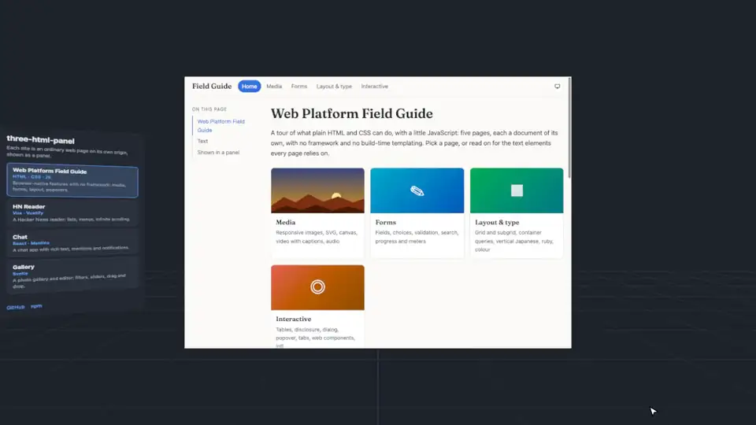

# three-html-panel

[](https://www.npmjs.com/package/@urth/three-html-panel)
[](https://github.com/urth-inc/three-html-panel/actions/workflows/ci.yml)
[](LICENSE)
[](https://bundlejs.com/?q=@urth/three-html-panel&config=%7B%22esbuild%22%3A%7B%22external%22%3A%5B%22three%22%5D%7D%7D)

Show web pages you control — scripts included, on any origin — as interactive panels in a three.js scene.

[](https://three-html-panel-demo.pages.dev/)

**[Live demo](https://three-html-panel-demo.pages.dev/)**: real sites, each on its own origin, as panels you can use in 3D.

- Mouse, touch and VR controllers: hover, click, drag, wheel and touch scrolling
- Keyboard and IME, text selection, copy and paste, undo
- Form controls (`<select>`, list boxes, checkboxes, sliders, text fields, contenteditable), scrollbars, video
- Untrusted pages run sandboxed, away from the host's cookies, storage and keyboard

```
 host page (three.js)                           panel page (any origin)
┌────────────────────────────────┐             ┌──────────────────────┐
│ HtmlPanel                      │    input    │ agent                │
│   PanelPointer / PanelKeyboard ├────────────>│   replays the input  │
│   texture <── SVG              │<────────────┤   copies the DOM     │
└────────────────────────────────┘    frames   └──────────────────────┘
                                   MessagePort
```

The page runs in an `<iframe>` and loads a small script, the **agent**. On every change, the agent copies the whole page into an SVG `<foreignObject>`, which the host decodes and draws into a texture; it replays the host's input in the page as DOM events.

### Before you start

- **Keep the page small**: every frame copies all of it. See [Performance](#performance-keep-the-page-small).
- **Every page shown must load the agent** ([one `<script>` tag](#adding-the-agent-to-a-page), or a proxy you run inserts it). Sites you do not control, such as YouTube, cannot be shown: this is not a browser in 3D.
- **Resources from other origins need CORS** to be drawn: images, stylesheets, fonts, video.
- **Not drawn**: iframes from other origins, and native widgets such as date pickers and video controls (`<select>`'s list is). See [Limitations](#limitations).

## Install

```bash
npm install @urth/three-html-panel three
```

three r158 or later (with `@types/three` 0.158 or later for TypeScript). The agent adds about 38 kB (gzip) to each panel page.

## Usage

```ts
import { HtmlPanel, PanelPointer } from "@urth/three-html-panel";

const panel = new HtmlPanel({
  url: "https://panels.example/notes/",
  width: 960,
  height: 640,
  size: 1.6,
  sandbox: true,
});
scene.add(panel);
new PanelPointer(camera, renderer.domElement, () => [panel]);

renderer.setAnimationLoop(() => renderer.render(scene, camera));
```

`renderer` can be a `WebGLRenderer` or a `WebGPURenderer` (tried with r186). For VR, add a `PanelXRPointer` (call its `update()` every frame) with a `PanelXRKeyboard`: there is no system keyboard in an immersive session. VR with a `WebGPURenderer` has not been tried.

| Option            | Default         | Meaning                                                      |
| ----------------- | --------------- | ------------------------------------------------------------ |
| `url`             |                 | The page. It must load the agent                             |
| `width`, `height` | 800, 600        | The page's size in CSS px                                    |
| `size`            | 1               | The panel's longer side in world units                       |
| `sandbox`         | `false`         | Run the page sandboxed (see Security)                        |
| `pixelRatio`      | 2 (1 on phones) | Texture pixels per CSS pixel, at most                        |
| `background`      | `#ffffff`       | Painted under transparent pages                              |
| `pauseWhenHidden` | `true`          | Pause capturing, then rest, while not drawn                  |
| `optimizeHover`   | `true`          | Skip captures for unchanged hover                            |
| `readyTimeout`    | 15000           | ms to wait for the agent before `onError`                    |
| `onLink`          | see below       | A link the user followed (http(s), right after acting on it) |
| `onMessage`       |                 | Data the page sent with `sendToHost()`                       |
| `onError`         | `console.warn`  | The agent did not connect, or speaks another protocol        |

By default, a link to the panel's own origin opens in the panel, any other in a new tab. If the page opened does not connect within `readyTimeout` (a PDF, say), the panel goes back and calls `onError`.

### Adding the agent to a page

The agent must run before the page's own scripts, and names the host's origin. With a tag, first in `<head>` (from a CDN, or from your server out of `node_modules/@urth/three-html-panel/lib/`):

```html
<script
  type="module"
  src="https://cdn.jsdelivr.net/npm/@urth/three-html-panel@0.3/lib/agent-script.js"
  data-host-origin="https://host.example"
></script>
```

Or first in the page's own bundle:

```ts
import { startAgent } from "@urth/three-html-panel/agent";
startAgent({ hostOrigin: "https://host.example" });
```

Several hosts (production and staging, say) are separated by spaces in `data-host-origin`, or a list in `hostOrigin`; if any is not exactly an origin, the agent does not start. `injectPanelAgent()` in `vite.panels.config.ts` inserts the tag into pages served for the demo.

### Messages between page and host

```ts
// In the page
import { onHostMessage, sendToHost } from "@urth/three-html-panel/page";
sendToHost({ color: "#3b82f6" });
onHostMessage((data) => console.log(data));

// On the host
new HtmlPanel({
  url,
  onMessage: (data) => {
    /* validate, then use */
  },
});
panel.postMessage("scene-click");
```

## Security

Loading the agent is how a page consents to being shown: the agent sends what the page shows, and only to the origins it names. Name fixed origins you trust, never one taken from the URL. A page that is not sandboxed may show the user's own data (a logged-in view); the named host receives that too.

- **`sandbox: false`** runs the page as an ordinary page of its origin. Use it only for pages you trust: a page on the host's origin can read the host's cookies and storage.
- **`sandbox: true`** is for pages you do not trust: `sandbox="allow-scripts allow-forms allow-popups"`, never `allow-same-origin`. The page cannot reach the host's cookies, storage or document, nor take the keyboard.

Either way, treat `onMessage` data as untrusted. Serve sandboxed pages with `Content-Security-Policy: sandbox allow-scripts allow-forms allow-popups`, and their assets with `Access-Control-Allow-Origin` (they are requested from the origin `null`). They have no cookies or `localStorage`: keep their state on a server.

## Performance: keep the page small

**This matters more than anything else.** Whenever the page changes (a key, a scroll step, an animation frame), the agent copies the whole page, and the host decodes the copy on its main thread. Everything in it is paid for on every frame, on every device:

- **the DOM**, including what is scrolled away, hidden or closed (`display: none` is copied too)
- **all of the CSS** (but `@media` rules that do not apply), a UI kit's rules the page never uses included
- **fonts and images**, embedded as data URLs

The demo's sites, one frame each at 1024×720:

| Site                                                      | Built with      | Elements | One frame  |
| --------------------------------------------------------- | --------------- | -------- | ---------- |
| [Timetable](examples/sites/timetable/)                    | HTML · CSS · TS | 53       | 18 kB      |
| [Web Platform Field Guide](examples/sites/web-standards/) | HTML · CSS · JS | 149      | 148 kB     |
| [Chat](examples/sites/chat/)                              | React · Mantine | 753      | 516 kB     |
| [HN Reader](examples/sites/hn-reader/)                    | Vue · Vuetify   | 1187     | 604 kB     |
| [Gallery](examples/sites/gallery/)                        | Svelte          | 326–456  | 413–859 kB |

With a 6× slower CPU (a phone, emulated), the larger frames take 90–310 ms each to decode, the Timetable's 20 ms. Most of the Field Guide's is three web fonts; of HN Reader's, Vuetify's CSS; of Gallery's, images.

What helps, most first:

- **Few elements.** Leave out what is not shown (rows far away, closed menus and dialogs) and add it when needed.
- **Little CSS.** Your own few rules, not a UI kit's.
- **System fonts, few and small images.**
- **No `var()` in shorthands** (`background`, `border`, ...): the copy writes them out into every element's style. Use longhands (`background-color`).
- **Change only what changed**: each change is a whole new frame.

A smaller `width` and `height` or a lower `pixelRatio` also make frames cheaper: see [docs/performance.md](docs/performance.md).

## Limitations

CSS transitions, and animations that end, jump to their end: move things by script, a value per frame. `backdrop-filter` is not drawn. contenteditable relies on `document.execCommand()`. No IME in VR. The rest: [docs/limitations.md](docs/limitations.md).

## Development

```bash
pnpm install
pnpm dev        # the demo: open http://localhost:5173 (its pages are served from :5174, another origin)
pnpm dev:live-demo  # the live demo (http://localhost:5179) and the example sites, with the published package
pnpm test       # unit tests
pnpm e2e        # Chromium, Firefox and WebKit (Playwright); install them once: pnpm exec playwright install
pnpm pack:lib   # the npm package, into lib/
pnpm build      # the demo, into dist/
vp check        # format, lint and types
```

`src/` is the library (`src/agent/` runs in panel pages). `examples/showcase/` is the demo scene; it shows the pages in `examples/sites/` that run `src/`. The sites there with a `package.json` use the published package instead, and only `examples/live-demo/` shows them. Other ports: set `VITE_HOST_ORIGIN` and `VITE_PANEL_ORIGIN` (see `.env.example`).
